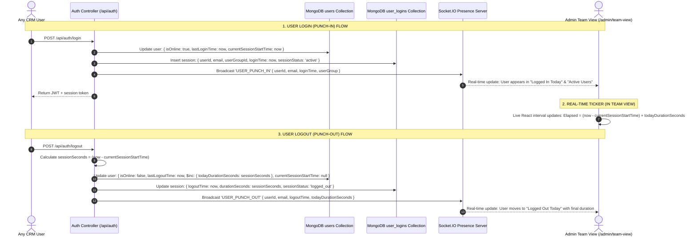
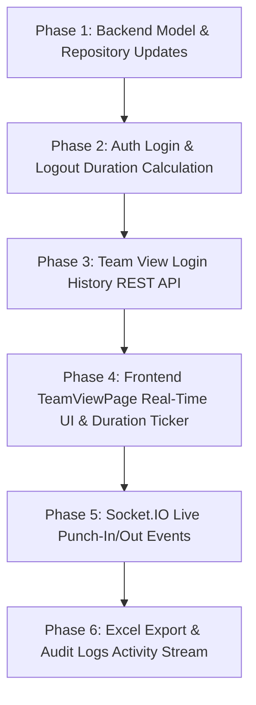

# Implementation Plan: Admin Team View User Login/Logout History & Session Duration Tracking (MongoDB Stored)

> [!IMPORTANT]
> **STRICT ADHERENCE:** This is an **ARCHITECTURAL IMPLEMENTATION PLAN ONLY**. **NO CODE IS IMPLEMENTED OR MODIFIED AT THIS STAGE.**
> 
> **Zero-Breakage Guarantee for Existing CRM Modules:**
> - Preserves 100% of existing **Add Account**, `ownerCode` backend, and account assignment logic.
> - Preserves 100% of **Add Deals**, Deal details, Deal creation, and automatic deal convert status.
> - Preserves 100% of **Add Quotations**, Revision quotations, Deal/Account quotation mechanisms, and **Quotation numbering sequences (`quotationNo` / `quotationNumber`)**.
> - Preserves 100% of **Add Customers** logic and customer creation pipelines.
> - Preserves 100% of **Mobile backend**, **Outlook OAuth / Microsoft Graph** mechanisms, and **Codex**.
> - Preserves 100% of existing **Reminders** and existing tasks.
> - **Direct MongoDB Data Guarantee:** All session history, user group assignments, punch in/out timestamps, and session durations are fetched directly from MongoDB collections (`users`, `user_logins`, `user_groups`, `audit_logs`). Zero mock or hardcoded local fallback arrays will be used.

---

## 1. Executive Summary & Objective

The objective of this feature is to enhance **Admin Team View (`http://localhost:3000/admin/team-view`)**, specifically under the **User Group** tab, to provide automated tracking, storage, and visualization of all users' authentication lifecycles:

1. **MongoDB `users` Collection Storage**:
   - Store real-time session attributes directly on each user document: `lastLoginTime` (Punch In), `lastLogoutTime` (Punch Out), `isOnline`, `currentSessionStartTime`, and `todayDurationSeconds` (accumulated active work duration for today).
2. **Login and Logout Tracking for ALL Users**:
   - Every login (web or mobile) triggers an automated punch-in record.
   - Every logout (explicit logout or session expiration) triggers an automated punch-out record, calculating the session duration and incrementing `todayDurationSeconds`.
3. **User Group Tab Integration in `http://localhost:3000/admin/team-view`**:
   - **Logged In Today**: Table showing users in the selected user group who logged in today, with Punch In time, Punch Out time, Today's Duration, Device/IP, and Online status.
   - **Active Users**: Cards for all currently online users showing a live ticker of their elapsed active duration.
   - **Login History**: Searchable, date-filterable, and exportable table of all historical sessions fetched directly from MongoDB `user_logins`.
   - **Today Duration Calculation**: If a user logs in and out multiple times during the same day, their durations accumulate cleanly into `todayDurationSeconds`.
4. **Recent Activity Stream Integration**:
   - Auto-generate formatted login/logout audit events with duration metrics in MongoDB `audit_logs` for display on the Admin Dashboard and Team View activity panels.

---

## 2. Architecture & Real-Time Data Flow



---

## 3. MongoDB Collections & Schema Design

### 3.1 MongoDB `users` Collection Schema Enhancement
In `server/models/mongoModels.js`, the `users` collection is enriched with session and duration tracking fields:

```javascript
// MongoDB 'users' Collection - Session & Duration Fields
{
  id: 1,                                  // Numeric legacyId / id
  _id: ObjectId("64f1a2b3c4d5e6f7a8b9c0d1"),
  name: "Rahul Sharma",
  email: "rahul@swatiswitchgears.com",
  role: "sales",
  designation: "Sales Executive",
  userGroup: "Sales Ahmedabad",
  userGroupId: "64f1a2b3c4d5e6f7a8b9c0e2",

  // --- Real-Time Attendance & Duration Fields ---
  isOnline: true,                         // Boolean: true if currently logged in
  lastLoginTime: ISODate("2026-10-12T09:15:00.000Z"),  // Punch-In timestamp
  lastLogoutTime: null,                   // Punch-Out timestamp (null while active)
  currentSessionStartTime: ISODate("2026-10-12T09:15:00.000Z"), // For live active ticker
  todayDate: "2026-10-12",                // Current tracking day (YYYY-MM-DD)
  todayDurationSeconds: 14700,            // Accumulated seconds today (4h 05m)
  lastIpAddress: "192.168.1.45",
  lastDeviceType: "Chrome / Windows",
  
  updatedAt: ISODate("2026-10-12T09:15:00.000Z")
}
```

### 3.2 MongoDB `user_logins` Collection Schema (Detailed Session History)
A dedicated collection `user_logins` stores each individual session event for full historical auditability:

```javascript
// MongoDB 'user_logins' Collection
{
  _id: ObjectId("670a5c12e4b0123456789abc"),
  legacyId: 4082,
  companyId: 1,
  userId: "1",                            // Reference to users.id / users.legacyId
  userEmail: "rahul@swatiswitchgears.com",
  userName: "Rahul Sharma",
  userGroupId: "64f1a2b3c4d5e6f7a8b9c0e2",
  userGroupName: "Sales Ahmedabad",
  userType: "Sales Executive",
  
  // Timestamps & Duration
  loginTime: ISODate("2026-10-12T09:15:00.000Z"),
  logoutTime: ISODate("2026-10-12T18:00:00.000Z"),
  durationSeconds: 31500,                 // Exactly 8 hours 45 minutes
  loginDate: "2026-10-12",                // YYYY-MM-DD for fast day indexing
  
  // Status & Device Metadata
  sessionStatus: "logged_out",            // 'active' | 'logged_out' | 'session_expired'
  ipAddress: "192.168.1.45",
  userAgent: "Mozilla/5.0 (Windows NT 10.0; Win64; x64)...",
  deviceType: "Chrome / Windows",
  clientType: "web",                      // 'web' | 'mobile'
  
  createdAt: ISODate("2026-10-12T09:15:00.000Z"),
  updatedAt: ISODate("2026-10-12T18:00:00.000Z")
}
```

### 3.3 MongoDB Collection Indexes
Add high-performance compound indexes in `server/models/mongoModels.js`:
```javascript
user_logins: [
  { fields: { legacyId: 1 }, options: { unique: true, sparse: true } },
  { fields: { companyId: 1, loginDate: -1 } },
  { fields: { userId: 1, sessionStatus: 1 } },
  { fields: { userEmail: 1, loginTime: -1 } },
  { fields: { userGroupId: 1, loginDate: -1 } },
]
```

---

## 4. Backend Implementation Details

### 4.1 Login Handler (`server/services/authService.js` & `authController.js`)
When **any user** logs in:
1. Determine local day string (`todayStr = new Date().toISOString().slice(0, 10)`).
2. Fetch current user from MongoDB `users` collection.
3. If `user.todayDate !== todayStr`:
   - Reset `todayDurationSeconds = 0`.
   - Update `todayDate = todayStr`.
4. Update `users` document:
   ```javascript
   await User.updateOne(
     { _id: user._id },
     {
       $set: {
         isOnline: true,
         lastLoginTime: now,
         currentSessionStartTime: now,
         todayDate: todayStr,
         lastIpAddress: requestMeta.ipAddress || '',
         lastDeviceType: `${requestMeta.browser || 'Browser'} / ${requestMeta.deviceName || 'Device'}`,
       },
       ...(user.todayDate !== todayStr ? { $set: { todayDurationSeconds: 0 } } : {})
     }
   )
   ```
5. Insert new `user_logins` record with `sessionStatus: 'active'`, `loginTime: now`.
6. Record audit log entry in MongoDB `audit_logs` (`action: 'user_login'`).
7. Broadcast `USER_PUNCH_IN` via Socket.IO.

### 4.2 Logout Handler (`server/services/authService.js` & `socketPresence.js`)
When **any user** logs out or socket disconnects:
1. Fetch user document from MongoDB `users`.
2. Compute session elapsed duration:
   ```javascript
   const sessionSeconds = user.currentSessionStartTime
     ? Math.max(0, Math.floor((new Date() - new Date(user.currentSessionStartTime)) / 1000))
     : 0
   ```
3. Update `users` document in MongoDB:
   ```javascript
   await User.updateOne(
     { _id: user._id },
     {
       $set: {
         isOnline: false,
         lastLogoutTime: now,
         currentSessionStartTime: null,
       },
       $inc: {
         todayDurationSeconds: sessionSeconds,
       }
     }
   )
   ```
4. Find active session in `user_logins` for this user and close it:
   ```javascript
   await UserLogin.updateOne(
     { userId: user.id, sessionStatus: 'active' },
     {
       $set: {
         logoutTime: now,
         durationSeconds: sessionSeconds,
         sessionStatus: 'logged_out',
       }
     }
   )
   ```
5. Record audit log entry in MongoDB `audit_logs` (`action: 'user_logout'`).
6. Broadcast `USER_PUNCH_OUT` via Socket.IO with updated `todayDurationSeconds`.

---

## 5. REST API Endpoints Specification

### 5.1 Team View Login & Duration Overview API
- **Endpoint**: `GET /api/admin/team-view/login-history`
- **Controller**: `server/controllers/teamViewController.js`
- **Query Parameters**:
  - `userGroupId` (optional): Filter by MongoDB User Group ID
  - `date` (optional): `YYYY-MM-DD` (Defaults to today)
  - `viewMode`: `logged-in-today` | `active-users` | `login-history` | `idle-users`
  - `search` (optional): Filter by name or email
  - `page`, `limit`: Pagination parameters

**JSON Response Contract (Direct from MongoDB)**:
```json
{
  "success": true,
  "summary": {
    "totalUsers": 24,
    "currentlyOnline": 9,
    "loggedOutToday": 11,
    "notLoggedInToday": 4,
    "totalTodayDurationSeconds": 182400,
    "totalTodayDurationFormatted": "50 hrs 40 mins",
    "avgSessionDurationFormatted": "4 hrs 12 mins"
  },
  "data": [
    {
      "userId": "1",
      "userName": "Rahul Sharma",
      "userEmail": "rahul@swatiswitchgears.com",
      "userGroup": "Sales Ahmedabad",
      "userType": "Sales Executive",
      "isOnline": true,
      "loginTime": "2026-10-12T09:15:00.000Z",
      "logoutTime": null,
      "currentSessionStartTime": "2026-10-12T09:15:00.000Z",
      "todayDurationSeconds": 14700,
      "todayDurationFormatted": "4 hrs 05 mins",
      "activeTickerBaseSeconds": 14700,
      "device": "Chrome / Windows",
      "ipAddress": "192.168.1.45",
      "status": "Online Now"
    },
    {
      "userId": "2",
      "userName": "Priya Patel",
      "userEmail": "priya@swatiswitchgears.com",
      "userGroup": "Sales Ahmedabad",
      "userType": "Sales Executive",
      "isOnline": false,
      "loginTime": "2026-10-12T08:30:00.000Z",
      "logoutTime": "2026-10-12T17:15:00.000Z",
      "currentSessionStartTime": null,
      "todayDurationSeconds": 31500,
      "todayDurationFormatted": "8 hrs 45 mins",
      "device": "Edge / Windows",
      "ipAddress": "192.168.1.88",
      "status": "Logged Out"
    }
  ],
  "pagination": {
    "totalRecords": 20,
    "totalPages": 1,
    "currentPage": 1
  }
}
```

---

## 6. Frontend UI/UX Design in `http://localhost:3000/admin/team-view`

### 6.1 Enhancing the User Group Tab in `TeamViewPage.jsx`
All changes will be implemented in [TeamViewPage.jsx](file:///c:/Users/DELL/OneDrive%20-%20Lumos/Desktop/New%20folder/Server-New-Vps-CRM/src/pages/admin/team-view/TeamViewPage.jsx) without breaking existing tab structures:

1. **Remove Hardcoded Data Fallbacks**:
   - Replace static `LOGIN_HISTORY_DATA` and `loggedInTodayUsers` with live state populated from `GET /api/admin/team-view/login-history`.
2. **Sub-view 1: Logged In Today Table**:
   - Table columns:
     - **Login Name / User**: User Avatar + Name + Email subtext
     - **User Group**: Badge layout (e.g. *Sales Ahmedabad*)
     - **User Type**: Designation tag (e.g. *Executive*, *Manager*)
     - **Login Time (Punch In)**: Formatted date-time (`12 Oct 2026, 09:15 AM`)
     - **Logout Time (Punch Out)**: Formatted date-time (`12 Oct 2026, 05:30 PM`) or Green Badge (`🟢 Active Now`)
     - **Today's Total Duration**:
       - For logged-out users: Clock icon + `8 hrs 45 mins`
       - For active users: Live dynamic ticker with elapsed time (e.g. `Active: 4h 12m 35s`)
     - **Device & IP**: Browser / OS and IP address
     - **Status**: `Online Now` (green) / `Logged Out` (gray)
3. **Sub-view 2: Active Users Cards Grid**:
   - Shows active online cards for each user in the selected group:
     - User Avatar + Name
     - User Group & Designation
     - Login Time: `09:15 AM`
     - Live Duration Badge: `<FaRegClock /> Active: 04:12:35` (increments every second)
4. **Sub-view 3: Login History**:
   - Historical sessions table from MongoDB `user_logins` with:
     - Date Range Picker (Today, Yesterday, This Week, This Month, Custom)
     - Pagination & records per page selector (10, 25, 50)
     - Excel Export handler exporting verified MongoDB records
5. **Sub-view 4: Idle Users**:
   - Calculated dynamically by checking `isOnline` and elapsed idle time from socket heartbeat or last activity.

### 6.2 Live Dynamic Duration Counter Algorithm
In `TeamViewPage.jsx`, a lightweight timer hook updates the display for active users every second without triggering redundant network calls:

```javascript
// Lightweight Active Session Duration Hook
useEffect(() => {
  const hasActiveUsers = displayUsers.some((u) => u.isOnline && u.currentSessionStartTime)
  if (!hasActiveUsers) return

  const timer = setInterval(() => {
    setNowTimestamp(Date.now())
  }, 1000)

  return () => clearInterval(timer)
}, [displayUsers])

const formatLiveDuration = (user, nowTime) => {
  if (!user.isOnline || !user.currentSessionStartTime) {
    return formatSecondsToHours(user.todayDurationSeconds || 0)
  }
  const currentSessionSecs = Math.max(0, Math.floor((nowTime - new Date(user.currentSessionStartTime).getTime()) / 1000))
  const totalSecs = (user.todayDurationSeconds || 0) + currentSessionSecs
  return formatSecondsToHours(totalSecs)
}
```

---

## 7. Recent Activity Feed Integration (MongoDB `audit_logs`)

Whenever a user punches in or punches out:
1. Create a document in the existing MongoDB `audit_logs` collection:
   ```javascript
   {
     action: 'user_punch_in', // or 'user_punch_out'
     userId: user.id,
     userName: user.name,
     userEmail: user.email,
     userGroup: user.userGroup,
     metadata: {
       punchTime: new Date(),
       durationSeconds: sessionDuration,
       ipAddress: ip,
       deviceType: device
     },
     createdAt: new Date()
   }
   ```
2. Recent Activity feeds on `/admin/dashboard` and Team View will render:
   - 🟢 **Rahul Sharma** (Sales Ahmedabad) logged in at **09:15 AM** (Chrome / Windows).
   - 🔴 **Rahul Sharma** (Sales Ahmedabad) logged out at **06:00 PM** (Today's Total Duration: **8 hrs 45 mins**).

---

## 8. Step-by-Step Implementation Roadmap



### Phase 1: Database & Model Updates
1. Add `user_logins` collection indexes and schema definitions in `server/models/mongoModels.js`.
2. Update `server/repositories/userRepository.js` to support `lastLoginTime`, `lastLogoutTime`, `isOnline`, `currentSessionStartTime`, and `todayDurationSeconds`.
3. Create `server/repositories/userLoginRepository.js` for session queries and aggregations.

### Phase 2: Auth Login/Logout Duration Computation
1. In `server/services/authService.js`:
   - On `login`: update `users` document (`isOnline: true`, `lastLoginTime`, `currentSessionStartTime`, day reset check) and insert `user_logins` record.
   - On `logoutUser`: calculate `sessionSeconds`, update `users` document (`isOnline: false`, `lastLogoutTime`, `$inc: { todayDurationSeconds }`), and close `user_logins` record.
2. In `server/socketPresence.js`:
   - When a socket disconnects with no remaining active connections, trigger graceful punch-out session completion.

### Phase 3: REST API & Controller
1. Create `server/controllers/teamViewController.js` with `getLoginHistory(req, res)` handling group filtering, date ranges, and pagination.
2. Register route `GET /api/admin/team-view/login-history` in `server/routes/teamViewRoutes.js` (or `userGroupRoutes.js`).

### Phase 4: Frontend Team View UI Enhancements
1. Update [TeamViewPage.jsx](file:///c:/Users/DELL/OneDrive%20-%20Lumos/Desktop/New%20folder/Server-New-Vps-CRM/src/pages/admin/team-view/TeamViewPage.jsx) under the `user-group` tab:
   - Connect `logged-in-today`, `active-users`, and `login-history` sub-views to the new MongoDB endpoint.
   - Remove hardcoded mock objects (`LOGIN_HISTORY_DATA`, `USER_ATTENDANCE`).
   - Implement the live duration ticker for active users.
   - Add Excel export handler using `exportExcelWorkbook`.

### Phase 5: Verification & Safety Validation
1. Verify database documents in MongoDB `users` and `user_logins`.
2. Verify production build with `npm run build`.
3. Ensure zero regression across Add Account, Deals, Quotations, and mobile backends.

---

## 9. Verification & Acceptance Criteria

| S.No | Verification Scenario | Expected Outcome |
| :--- | :--- | :--- |
| **1** | **Login Punch-In in MongoDB** | User logs into CRM ➔ MongoDB `users` records `lastLoginTime` and `isOnline: true`, and new `user_logins` record is created. |
| **2** | **Logout Punch-Out in MongoDB** | User logs out ➔ MongoDB `users` records `lastLogoutTime`, `isOnline: false`, and computes `todayDurationSeconds`. `user_logins` session is closed. |
| **3** | **Multiple Logins in Same Day** | User logs in for 2 hours, logs out, logs in again for 3 hours ➔ `todayDurationSeconds` accumulates to exactly 5 hours. |
| **4** | **Next Day Reset** | User logs in the next calendar day ➔ `todayDurationSeconds` automatically resets to 0 for the new day. |
| **5** | **Live Duration Ticker in Team View** | Navigate to `http://localhost:3000/admin/team-view` ➔ Active users show dynamic live counter updating every second. |
| **6** | **User Group Filtering** | Filter by "Sales Ahmedabad" ➔ Displays only MongoDB users belonging to that group with their real login/logout times and durations. |
| **7** | **Login History Table & Excel Export** | Select date range ➔ Historical sessions table displays all logs from MongoDB; clicking Excel Export downloads verified `.xlsx`. |
| **8** | **Zero CRM Regressions** | Add Account, Add Deals, Add Quotations, Quotation numbering sequences (`quotationNo`), Mobile backend remain 100% untouched and functional. |
