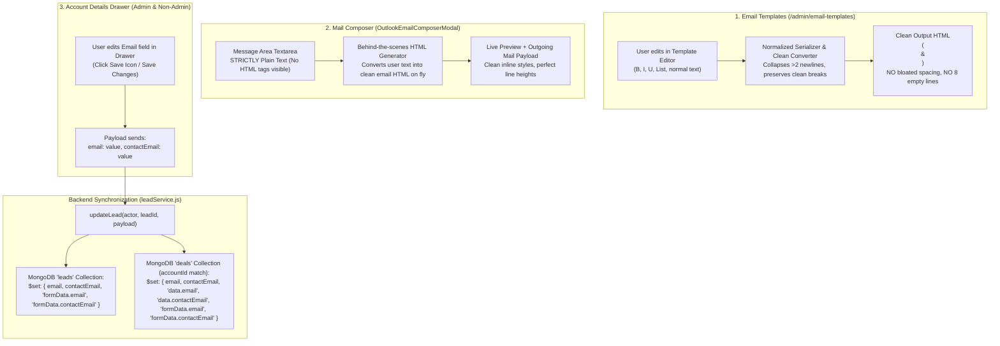

# Implementation Plan: Email Template Normalization, Mail Composer Clean Text, & Dual Account/Deal Email Sync

> **STRICT ADHERENCE:** This is an **IMPLEMENTATION PLAN ONLY**. **NO CODE HAS BEEN MODIFIED OR IMPLEMENTED.**
> All changes will only be executed after your explicit review and approval.
> 
> **Zero-Breakage Guarantee:**
> - Will **NOT** touch or alter Add Account mechanism, logic, or forms.
> - Will **NOT** touch or alter `ownerCode` backend or assignment logic.
> - Will **NOT** touch or alter Add Deals, Deal details backend, Deal creation, or Deal convert status.
> - Will **NOT** touch or alter Add Quotations logic, Revision quotations, Deal/Account quotation mechanisms, or **quotation numbering sequence (`quotationNo` / `quotationNumber`)**.
> - Will **NOT** touch or alter Add Customers logic & backend.
> - Will **NOT** touch or alter Mobile backend.
> - Will **NOT** touch or alter Outlook OAuth backend / Microsoft Graph mechanism.
> - Will **NOT** touch or alter Tasks mechanism, Add Reminders form/popup, Converted deals new tab opening view, Codex, or Graph/chart mechanisms.
> - Will **NOT** hardcode any values.

---

## 1. Problem Analysis & Root Causes

### Problem 1: Email Template Editor (`http://localhost:3000/admin/email-templates`)
- **Current Behavior:**
  When typing or pasting formatted text into the template editor (e.g., standard business proposal letter with paragraph breaks), the generated HTML contains bloated line spacing and 8+ excessive blank lines.
- **Root Cause:**
  1. `EmailTemplatesPage.jsx` uses a `contentEditable` div (`editorRef`). When `updateEditorBody()` is triggered, it extracts `editorRef.current.innerText`.
  2. In Chromium browsers, `contentEditable` paragraph breaks create nested `<div><br></div>` or `<p>` elements. Extracting `innerText` creates multiple newline characters (`\n\n` or `\n\n\n`).
  3. `buildTemplateBodyHtml()` takes this text and wraps it in `<div style="white-space:pre-wrap; ...">${content}</div>`. In HTML email rendering, `white-space: pre-wrap` preserves every single newline.
  4. When `editTemplate()` loads the template, `htmlToPlainText()` runs:
     ```javascript
     .replace(/<br\s*\/?>/gi, '\n')
     .replace(/<\/(div|p|li|tr|h[1-6])>/gi, '\n')
     ```
     This turns closing `</div>` and `<br>` into *additional* newlines on every load/save round-trip, causing exponential line multiplication (1 blank line -> 2 -> 4 -> 8+ blank lines).
  5. The toolbar formatting buttons (**B**, **I**, **U**, **List**) execute `document.execCommand(...)` which creates HTML tags (`<b>`, `<i>`, etc.), but `updateEditorBody` immediately reads `innerText`, stripping all tags and overwriting the content with plain text.

---

### Problem 2: Mail Composer Message Area (Outlook / CRM Email Composer)
- **Current Behavior:**
  In the Mail Composer modal (`OutlookEmailComposerModal.jsx`) and compose page (`OutlookEmailComposePage.jsx`), raw HTML tags (e.g., `<div>`, `<p>`, `<span>`, `style="..."`) can leak into the Message Area textarea when templates or prefilled messages are loaded. Furthermore, editing the message must not require the user to write or read HTML code.
- **Root Cause:**
  1. `message` state initialization uses `useState(defaultMessage)` directly without guaranteeing HTML-to-plain-text conversion.
  2. When resolved templates contain HTML or encoded entities, partial entity decoding (`&lt;p&gt;` becoming `<p>`) leaves raw HTML tags visible in the textarea.
  3. The textarea needs to strictly hold human-friendly **plain text**. When the user types or edits text, the application must generate clean, compliant HTML behind the scenes for sending (`outgoingMessage`) and live preview, without excessive line gaps or tag leakage.

---

### Problem 3: Account Email Field Editing & Dual-Collection MongoDB Sync
- **Current Behavior:**
  On both admin and non-admin account routes:
  - `http://localhost:3000/admin/accounts/my-accounts?stage=new&page=1&accountId=123`
  - `http://localhost:3000/admin/accounts/search?stage=new&page=1&accountId=123`
  - `http://localhost:3000/accounts/my-accounts?stage=new&page=1&accountId=123`
  - `http://localhost:3000/accounts/search?stage=new&page=1&accountId=123`
  When an account is opened in `AccountDetailsDrawer.jsx` and the user edits the `Email` field and clicks the **Save icon** (`<FaSave />`) or the **Save Settings / Save Changes button**, the value must reliably update and store in **both** fields: `email` and `contactEmail` across **both** MongoDB collections:
  1. `leads` collection (account document)
  2. `deals` collection (all linked deal documents for this account)
- **Root Cause:**
  1. Frontend `AccountDetailsDrawer.jsx`: `buildInitialForm` initializes `email` but should cleanly synchronize both `form.email` and `form.contactEmail`.
  2. Backend `leadService.js`: In `buildLeadPayload`, top-level `contactEmail` is not explicitly assigned alongside `email`.
  3. In `leadService.updateLead`, when `payload.email` or `payload.contactEmail` is provided, MongoDB `leads` collection is updated via `leadRepository.updateLead` which may omit top-level `contactEmail`. An explicit MongoDB `$set` targeting both `email` and `contactEmail` (and `formData.email` and `formData.contactEmail`) on both `leads` and `deals` collections ensures guaranteed dual persistence for both admin and non-admin updates.

---

## 2. Detailed Technical Solution Architecture



---

## 3. Step-by-Step Implementation Steps

### Step 1: Fix Email Template Editor Spacing & Rich-Text HTML Generation (Changes-1)
**File to modify:** `src/pages/admin/email-templates/EmailTemplatesPage.jsx`

1. **Implement Robust Text & HTML Normalizers:**
   - Create a clean text normalizer `cleanTextContent(text)` that:
     - Normalizes carriage returns (`\r\n` -> `\n`).
     - Collapses sequences of 3 or more newlines down to maximum 2 newlines (`\n\n`), preventing exponential whitespace duplication.
     - Strips trailing whitespace per line.
   - Create a clean HTML generator `generateCleanEmailHtml(textOrHtml)`:
     - Splits text blocks on double newlines (`\n\n`) into paragraphs:
       `<p style="margin:0 0 12px 0; font-family:Arial,sans-serif; font-size:14px; line-height:1.5; color:#111827;">...</p>`.
     - Converts single newlines (`\n`) within paragraphs into clean `<br/>` tags.
     - Does **not** wrap everything in `white-space: pre-wrap`, preventing email clients and browsers from rendering double margins and 8+ empty lines.
   - Create a clean HTML-to-Plain-Text extractor `htmlToCleanPlainText(html)`:
     - Safely strips style/script blocks.
     - Converts `<br>`, `<p>`, `<div>` boundaries into single clean newlines without duplicating.
     - Decodes standard HTML entities (`&amp;`, `&lt;`, `&gt;`, `&quot;`, `&#39;`, `&nbsp;`).
     - Normalizes multiple blank lines to at most one empty line between sections.

2. **Fix Toolbar Commands (Bold, Italic, Underline, List):**
   - When executing `applyEditorCommand('bold' | 'italic' | 'underline' | 'insertUnorderedList')`:
     - Maintain rich-text formatting inside `editorRef`.
     - Update editor state without wiping out inner HTML tags.
   - Synchronize `editorRef.current.innerHTML` safely so user-applied formatting is preserved in the generated HTML code.

3. **Update Live Preview and Generated Code Box:**
   - Update `email-template-generated-html` textarea to display the exact clean generated HTML code reflecting visible text without inflated whitespace.
   - Update `renderBodyPreview` to render clean HTML with identical paragraph margins and line breaks.

---

### Step 2: Ensure Mail Composer Message Area Shows Pure Plain Text (Changes-2)
**File to modify:** `src/components/integrations/OutlookEmailComposerModal.jsx` (and `OutlookEmailComposePage.jsx`)

1. **Strict Plain-Text State for Message Area:**
   - Wrap initial state `defaultMessage` with `htmlToCleanPlainText(defaultMessage)`:
     ```javascript
     const [message, setMessage] = useState(() => htmlToCleanPlainText(defaultMessage))
     ```
   - When templates are selected and resolved via `emailTemplateApi.resolve`:
     ```javascript
     setMessage(htmlToCleanPlainText(resolved.bodyHtml || ''))
     ```
   - Ensure the `<textarea className="oec-textarea">` strictly displays user-readable plain text without any HTML tags (`<p>`, `<div>`, `<span>`, `style=...`).

2. **Transparent Behind-the-Scenes HTML Generation:**
   - When user edits the text in the Message Area:
     - `message` state updates with plain text as typed.
     - `buildEmailHtml(message, signatureImage, signatureSrc)` automatically generates clean, email-safe HTML behind the scenes:
       - Single newlines become `<br/>`.
       - Double newlines become paragraphs with standard margin (`margin: 0 0 12px 0`).
       - Appends signature image cleanly below the message body.
   - The generated HTML is transparently sent to Outlook via `integrationApi.sendOutlookEmail(payload)`.
   - The preview box below the textarea renders the formatted HTML version so the user can verify the email before sending.

---

### Step 3: Account Email Field Sync in MongoDB `leads` and `deals` Collections (Changes-3)
**Files to inspect & update:**
1. `src/pages/admin/accounts/AccountDetailsDrawer.jsx`
2. `server/services/leadService.js`
3. `server/repositories/leadRepository.js`

1. **Frontend (`AccountDetailsDrawer.jsx`):**
   - In `buildInitialForm(account, deal)`:
     - Ensure both `email` and `contactEmail` are initialized:
       ```javascript
       email: account.email || account.contactEmail || account.formData?.email || '',
       contactEmail: account.contactEmail || account.email || account.formData?.contactEmail || '',
       ```
   - In `handleFieldChange(key, value)`:
     - When `key === 'email'` or `key === 'contactEmail'`, sync both keys in form state:
       ```javascript
       if (key === 'email' || key === 'contactEmail') {
         setForm((current) => ({
           ...current,
           email: value,
           contactEmail: value,
         }))
         return
       }
       ```
   - In `buildUpdatePayload(form)`:
     - Ensure both fields are passed in the update payload:
       ```javascript
       email: form.email || form.contactEmail || '',
       contactEmail: form.email || form.contactEmail || '',
       ```
   - Verify that clicking the Save icon (`<FaSave />`) or "Save Changes" button invokes `onSaveAccount` with both fields for all routes (`/admin/accounts/my-accounts`, `/admin/accounts/search`, `/accounts/my-accounts`, `/accounts/search`).

2. **Backend (`server/services/leadService.js`):**
   - In `buildLeadPayload(payload, actor, existingLead)`:
     - Ensure `normalizedPayload` sets both `email` and `contactEmail` at top level and inside `formData`:
       ```javascript
       email: sanitizedPayload.email ?? sanitizedPayload.contactEmail ?? existingLead?.email ?? existingLead?.contactEmail ?? '',
       contactEmail: sanitizedPayload.contactEmail ?? sanitizedPayload.email ?? existingLead?.contactEmail ?? existingLead?.email ?? '',
       ```
   - In `updateLead(actor, leadId, payload)`:
     - Check if `payload.email !== undefined || payload.contactEmail !== undefined`.
     - Extract `nextEmail = String(payload.email ?? payload.contactEmail ?? '').trim()`.
     - Update **MongoDB `leads` collection** for the account document:
       ```javascript
       await Lead.updateMany(
         { $or: [{ legacyId: normalizeLeadId(leadId) }, { id: String(leadId) }, { _id: String(leadId) }] },
         {
           $set: {
             email: nextEmail,
             contactEmail: nextEmail,
             'formData.email': nextEmail,
             'formData.contactEmail': nextEmail,
             updatedAt: new Date().toISOString(),
           }
         }
       )
       ```
     - Update **MongoDB `deals` collection** for all linked deals:
       ```javascript
       await Deal.updateMany(
         { $or: [{ accountId: normalizeLeadId(leadId) }, { accountId: String(leadId) }], frontendDeleted: { $ne: true } },
         {
           $set: {
             email: nextEmail,
             contactEmail: nextEmail,
             'data.email': nextEmail,
             'data.contactEmail': nextEmail,
             'formData.email': nextEmail,
             'formData.contactEmail': nextEmail,
             updatedAt: new Date().toISOString(),
           }
         }
       )
       ```
   - In `server/repositories/leadRepository.js` (`mapLeadRow`):
     - Ensure `contactEmail` is returned in the mapped lead object:
       ```javascript
       contactEmail: row.contactEmail || row.email || mergedFormData.contactEmail || mergedFormData.email || '',
       ```

---

## 4. Verification and Testing Plan

### Test 1: Email Template Editor Spacing (`/admin/email-templates`)
1. Open `http://localhost:3000/admin/email-templates`.
2. Paste the user's sample proposal text with standard paragraphs and signature:
   ```
   Dear Sir/Mam,
   Greetings from the Swati Switchgears (India) Pvt Ltd !

   Please find attached Techno-Commercial proposal of Electrical panel.
   In case of any query, please feel free to contact us as under signature.

   We hope that this is in line with your requirements, so awaiting your positive response.
   Looking to serve you better in this and all future projects of yours.

   Thanks & Regards,
    
   JAY PANDYA
   Swati Switchgears (India) Pvt. Ltd.
   www.swatiswitchgears.com
   (M) :- +91-78744 47297
   ```
3. Verify that the generated HTML has clean paragraph tags and no stacked empty lines.
4. Verify toolbar buttons (**B**, **I**, **U**, **List**) format correctly without wiping text or adding blank lines.
5. Save the template, refresh the page, reload the template, and verify spacing remains identical without any exponential newline growth.

### Test 2: Mail Composer Message Area
1. Open the Mail Composer from an account or deal (or via `/integrations/outlook-compose/account/123`).
2. Verify that the Message Area textarea displays 100% human-readable plain text without any HTML tags (`<p>`, `<div>`, etc.).
3. Edit the text in the Message Area (add or remove a paragraph).
4. Verify the preview updates cleanly with proper line breaks and signature attachment.
5. Send a test email and verify that the received Outlook email contains clean styling without excessive gaps.

### Test 3: Account Email Field & Dual-Document MongoDB Sync
1. Log in as an **Admin**:
   - Navigate to `http://localhost:3000/admin/accounts/my-accounts?stage=new&page=1&accountId=123`
   - Edit the `Email` field to `testadmin@swatiswitchgears.com`.
   - Click the **Save icon** / "Save Changes".
   - Check MongoDB `leads` collection: verify `email: "testadmin@swatiswitchgears.com"` and `contactEmail: "testadmin@swatiswitchgears.com"`.
   - Check MongoDB `deals` collection: verify all linked deals for account `123` have `email: "testadmin@swatiswitchgears.com"` and `contactEmail: "testadmin@swatiswitchgears.com"`.
2. Repeat on `http://localhost:3000/admin/accounts/search?stage=new&page=1&accountId=123`.
3. Log in as a **Non-Admin User**:
   - Navigate to `http://localhost:3000/accounts/my-accounts?stage=new&page=1&accountId=123` and `http://localhost:3000/accounts/search?stage=new&page=1&accountId=123`.
   - Edit the `Email` field to `testuser@swatiswitchgears.com`.
   - Click the **Save icon** / "Save Changes".
   - Verify both `email` and `contactEmail` update in MongoDB `leads` and `deals` collections.
4. Verify regression test:
   - Ensure Add Account, Add Deals, Add Quotations, Add Customers, quotation number generation, and tasks remain completely unaffected.
