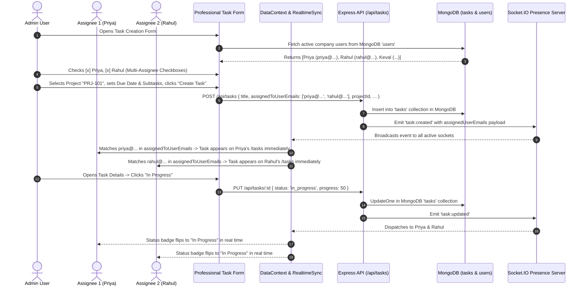
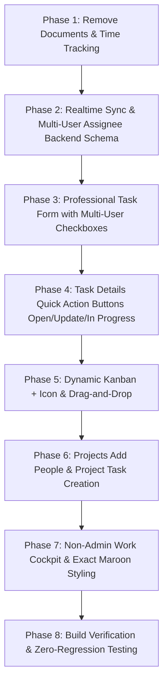

# Updated Implementation Plan: Enterprise Tasks & Projects Refinement (Swati CRM)

> [!IMPORTANT]
> **STRICT ADHERENCE:** This is an **ARCHITECTURAL IMPLEMENTATION PLAN ONLY**. **NO PRODUCTION CODE IS IMPLEMENTED OR MODIFIED AT THIS STAGE.**
> 
> **Zero-Breakage Guarantee for Existing CRM Modules:**
> - Preserves 100% of existing **Add Account**, `ownerCode` backend, and account assignment logic.
> - Preserves 100% of **Add Deals**, Deal details, Deal creation, and automatic deal convert status.
> - Preserves 100% of **Add Quotations**, Revision quotations, Deal/Account quotation mechanisms, and **Quotation numbering sequences (`quotationNo` / `quotationNumber`)**.
> - Preserves 100% of **Add Customers** logic and customer creation pipelines.
> - Preserves 100% of **Mobile backend**, **Outlook OAuth / Microsoft Graph** mechanisms, and **Codex**.
> - Preserves 100% of existing **Reminders** and existing tasks.
> - **Direct MongoDB Data Guarantee:** All task data, projects, user assignments, checklist subtasks, and statuses are read from and stored directly in MongoDB collections (`tasks`, `work_projects`, `users`, `audit_logs`). Zero mock or hardcoded local fallback data will be used.

---

## 1. Executive Summary & Core Updates

This updated implementation plan addresses all user feedback on the Enterprise Tasks & Projects architecture:

1. **Checkbox-Based Multi-User Assignee Selection (MongoDB `users` Driven)**:
   - In the **Professional Task Creation Form**, replace single assignee select with an interactive **Multi-User Checkbox List** allowing admins and users to check multiple team members to assign a task to multiple people in real-time.
   - Users are queried directly from the MongoDB `users` collection (`name`, `email`, `role`, `department`).
   - The task document stores an array `assignedToUserEmails: [email1, email2, ...]` (alongside `assignedTo` for backward compatibility), and Socket.IO pushes the real-time event to every assigned user simultaneously.

2. **Full Admin vs. Non-Admin Workflow & Scoping Parity**:
   - **Admin Side (`/admin/tasks/*`)**:
     - **3-Level Organizational Visibility**:
       - *Level 1*: Organization KPI Cards (Total Tasks, Completed, Overdue, Projects, SLA Breached, Approvals).
       - *Level 2*: User-Wise Performance Summary Drilldown (Employee, Tasks, Done, Pending, Overdue, Projects, Workload %).
       - *Level 3*: Project-Wise Overview Drilldown (Project, Tasks, Done, Progress, Team, SLA).
     - Full management across `/admin/tasks/all`, `/admin/tasks/projects`, `/admin/tasks/workload`, `/admin/tasks/workflows`, `/admin/tasks/approvals`, `/admin/tasks/activity`.
   - **Non-Admin Side (`/tasks/*`)**:
     - **Personal Execution Cockpit (`/tasks` & `/tasks/my-work`)**:
       - Scoped KPI Cards: *My Tasks*, *Overdue*, *SLA At Risk*, *My Projects*.
       - Today's Work Agenda & quick action button `+ New Task`.
     - **Scoped Task Workspace (`/tasks/all`)**: Shows only tasks assigned to the user (via single or multi-assignee array), created by the user, or where they are followers.
     - **Scoped Projects (`/tasks/projects`)**: Shows only projects where the user is a team member, manager, or has assigned tasks.
     - **Personal Workload (`/tasks/workload`)**: Shows the user's active tasks, estimated hours, and capacity bar.
     - **Personal Approvals (`/tasks/approvals`)**: Shows submitted approvals and pending decisions for them.
     - **Personal Activity (`/tasks/activity`)**: Shows their own recent actions and audit trail.

3. **Exact Maroon Theme & UI Styling for `http://localhost:3000/tasks/*`**:
   - Non-admin task routes will share the **exact same Swati Maroon visual identity** as `http://localhost:3000/admin/tasks/*`:
     - Primary Maroon Accent: `#c60016` (Swati Maroon)
     - Dark Maroon Hover / Borders: `#80000e` / `#991b1b`
     - Light Maroon Tints / Badges: `#fef2f2` / `rgba(198, 0, 22, 0.08)`
     - Crisp Light Mode Surface: `#ffffff` cards, `1.5px solid #e2e8f0` borders, `#f8fafc` table headers, text `#1e293b`.
     - Navigation tab bar matching `.ap-tabbar` and `.ap-tab--active` maroon underlines.

4. **Task Details Drawer Quick Action Buttons & Real-Time Sync**:
   - Prominent clickable **Open**, **In Progress**, and **Update** buttons inside the Task Details drawer that immediately persist to MongoDB `tasks` collection and notify all assigned non-admin users via Socket.IO.

5. **Dynamic Kanban Board with `+` Icon & Full Drag-and-Drop**:
   - Header `+` icon on all columns (`Open`, `In Progress`, `Under Review`, `Completed`).
   - Drag-and-drop updates MongoDB `tasks` directly.

6. **Complete Removal of Documents Vault & Time-Tracking (Changes-3 Intact)**:
   - Permanently removed from routes, sidebar navigation, tab bars, controllers, and MongoDB models.

---

## 2. Technical Architecture & Multi-User Data Flow



---

## 3. Detailed Component & Implementation Specifications

### 3.1 Professional Task Creation Form with Multi-User Assignee Checkboxes

Replace the basic modal with [ProfessionalTaskModal.jsx](file:///c:/Users/DELL/OneDrive%20-%20Lumos/Desktop/New%20folder/Server-New-Vps-CRM/src/components/common/ProfessionalTaskModal.jsx) designed with the look-and-feel of the CRM's **Add Account** and **Add Deal** workflows:

#### Multi-User Assignee Checkbox Component:
- **Searchable User List**: Search box to quickly find users by name, email, or department.
- **Checkbox Row for Each MongoDB User**:
  - Checkbox `<input type="checkbox" />`
  - User Avatar with user initials
  - User Full Name (`#1e293b`, font weight 700)
  - User Email (`#64748b`, font size 0.76rem)
  - Role / Department Tag (`Sales`, `Operations`, `Engineering`)
- **Selected Users Pill Bar**: Shows active pills of selected users with `(x)` to easily remove.
- **Select All / Clear All Shortcuts** for fast collaboration assignment.

#### Multi-Section Form Layout:

| Section | Fields & Integration Details | Visual Treatment |
| :--- | :--- | :--- |
| **1. Header & Identity** | Task Title/Subject (Required), Task Category, Priority Indicator (Low, Medium, High, Urgent with colored badges) | Swati Maroon header badge (`#c60016`), bold clean typography |
| **2. Description & Scope** | Formatted description, expected deliverables, acceptance criteria | Clean border input with placeholder guidance |
| **3. Assignees (MongoDB Users)** | **Checkbox list of users from MongoDB `users` collection**, multi-select followers/watchers, creator | Scrollable checkbox list with search bar & selected count badge |
| **4. CRM & Project Linking** | Project dropdown (`work_projects`), Deal dropdown (`deals`), Account dropdown (`accounts`), Customer dropdown (`customers`), Quotation dropdown | Linked CRM entity chips with direct reference codes |
| **5. Scheduling & SLA** | Start Date & Time, Due Date & Time, Estimated Effort (Hours/Minutes), SLA Target Policy | Dual calendar pickers with icon indicators |
| **6. Interactive Checklist** | Dynamic subtask builder (Subtask title, Assignee dropdown, Target due date) | Add subtask row with remove button & auto-progress calculation |
| **7. Tags & Priority** | Categorization tags (`Fabrication`, `Electrical`, `Urgent`, `Site Inspection`, `Client Review`) | Clickable tag pills |

---

### 3.2 Task Details Drawer Quick Actions & Real-Time Sync to Non-Admin Users

In [TasksWorkspacePage.jsx](file:///c:/Users/DELL/OneDrive%20-%20Lumos/Desktop/New%20folder/Server-New-Vps-CRM/src/pages/tasks/TasksWorkspacePage.jsx):

1. **Prominent Status Action Buttons**:
   - **`Open` Button**:
     - Visual: Clean blue pill button `<FaFolderOpen /> Open`.
     - Action: Sets `status = 'open'` in MongoDB `tasks` collection.
   - **`In Progress` Button**:
     - Visual: Emerald green button `<FaPlay /> In Progress`.
     - Action: Sets `status = 'in_progress'` in MongoDB `tasks` collection.
   - **`Update` Button**:
     - Visual: Swati Maroon button `<FaCheck /> Update Task Details` (`#c60016`).
     - Action: Persists all edited drawer fields (title, description, assignees, priority, due date, subtasks) directly to MongoDB in real-time.

2. **Real-Time Push to Non-Admin Users (`realtimeSync.js`)**:
   - In `src/services/realtimeSync.js`, update `matchesUserScope(record, user)`:
     ```javascript
     const userEmail = String(user?.email || user?.username || '').trim().toLowerCase()
     const assignedEmails = Array.isArray(record?.assignedToUserEmails)
       ? record.assignedToUserEmails.map((e) => String(e || '').trim().toLowerCase())
       : []
     const singleAssigned = String(record?.assignedTo || '').trim().toLowerCase()
     const createdBy = String(record?.createdBy || '').trim().toLowerCase()
     const followers = Array.isArray(record?.followers)
       ? record.followers.map((f) => String(f || '').trim().toLowerCase())
       : []

     if (
       assignedEmails.includes(userEmail) ||
       singleAssigned === userEmail ||
       createdBy === userEmail ||
       followers.includes(userEmail) ||
       String(record?.assignedTo) === String(user?.id)
     ) {
       return true
     }
     ```
   - This ensures whenever an admin clicks **Open**, **In Progress**, or **Update**, the task payload reaches **all assigned non-admin users** and their task lists update instantly via Socket.IO without page reloads.

---

### 3.3 Dynamic Kanban Board (`+` Icon & Drag-and-Drop)

1. **Column Header `+` Icon**:
   - On each column header (`Open`, `In Progress`, `Under Review`, `Completed`), render a clean add button:
     ```jsx
     <button
       type="button"
       className="kanban-col-add-btn"
       onClick={() => handleOpenAddModalWithStatus(col.key)}
       title={`Add Task to ${col.label}`}
     >
       <FaPlus />
     </button>
     ```
   - Clicking opens `ProfessionalTaskModal` with `status: col.key` pre-selected.

2. **Full Drag & Drop with MongoDB Persistence**:
   - HTML5 drag handlers (`onDragStart`, `onDragOver`, `onDrop`) on cards and column drop zones.
   - Dropping a card calls `updateTask(taskId, { status: targetStatus, progress: targetStatus === 'completed' ? 100 : 50 })`.
   - Triggers `PUT /api/tasks/:id` to update the document in MongoDB `tasks` collection and emits `task:updated` to all connected clients.

---

### 3.4 Projects People Allocation & Project-Wise Task Creation (`/admin/tasks/projects` & `/tasks/projects`)

1. **Add People to Projects**:
   - In [ProjectsPortfolioPage.jsx](file:///c:/Users/DELL/OneDrive%20-%20Lumos/Desktop/New%20folder/Server-New-Vps-CRM/src/pages/tasks/ProjectsPortfolioPage.jsx), each project card features an **"Add People / Team"** button and avatar stack.
   - Clicking opens an interactive team member selector modal populated directly from MongoDB `users`.
   - Admin/Manager can check multiple team members to assign to the project (`teamMemberEmails: []` stored in MongoDB `work_projects` collection).
2. **"Create Task" Button on Project Card**:
   - Prominent button `<FaPlus /> Add Task` on each project card.
   - Clicking opens the `ProfessionalTaskModal` with `projectId: proj.id`, `projectCode: proj.projectCode`, and `projectTitle: proj.name` pre-locked.
   - Shows active vs. completed tasks for that project computed from MongoDB `tasks`.

---

### 3.5 Admin vs. Non-Admin Comprehensive Workflow & Scope Matrix

| Feature / Page | Admin View (`/admin/tasks/*`) | Non-Admin View (`/tasks/*`) |
| :--- | :--- | :--- |
| **Management Dashboard (`/admin/tasks` vs `/tasks`)** | **3-Level Organizational View**:<br>• *Level 1*: Org KPI Cards (Total Tasks, Done, Overdue, Active Projects, SLA Breaches, Pending Approvals).<br>• *Level 2*: User-Wise Performance Summary Drilldown (Employee, Tasks, Done, Pending, Overdue, Projects, Workload %).<br>• *Level 3*: Project-Wise Drilldown (Project, Tasks, Done, Progress, Team, SLA). | **Personal Execution Cockpit**:<br>• Personal KPI Cards (*My Tasks*, *Completed*, *Overdue*, *My Projects*, *SLA At Risk*).<br>• Today's Work Execution Agenda.<br>• Quick Action `+ New Task`. |
| **Tasks Workspace (`/admin/tasks/all` vs `/tasks/all`)** | **All Tasks Across Organization**:<br>• Filter by any User, Team, Project, Account, Deal, Quotation, Priority, Status, Due Date.<br>• Full List View and Kanban Board. | **My Tasks Only**:<br>• Shows only tasks where user is in `assignedToUserEmails`, `assignedTo`, `createdBy`, or `followers`.<br>• Full List View and Kanban Board with identical Maroon styling. |
| **Projects (`/admin/tasks/projects` vs `/tasks/projects`)** | **All Organization Projects**:<br>• Add People from MongoDB users.<br>• Create project-bound tasks.<br>• Track all project milestones. | **My Projects Only**:<br>• Shows only projects where user is manager, team member, or has assigned tasks. |
| **Workload (`/admin/tasks/workload` vs `/tasks/workload`)** | **Team Workload Overview**:<br>• Capacity and active task load across all employees.<br>• Workload percentage bar (identifies overloaded users > 100%). | **My Workload Only**:<br>• Personal capacity card (Active Tasks, Estimated Hours, Capacity %). |
| **Approvals (`/admin/tasks/approvals` vs `/tasks/approvals`)** | **All Company Approvals**:<br>• Pending, Approved Today, Rejected. | **My Approvals Only**:<br>• Approvals submitted by user and items pending user's decision. |
| **Activity (`/admin/tasks/activity` vs `/tasks/activity`)** | **Organization Activity Log**:<br>• Filterable feed of all team task, project, and milestone events. | **My Activity Only**:<br>• Audit trail of actions performed by or assigned to the user. |
| **Reminders (`/admin/tasks/reminders` vs `/tasks/reminders`)** | Organization task reminders. | User's own task reminders. |

---

### 3.6 Exact Maroon Theme & UI Styling for `http://localhost:3000/tasks/*`

All user-facing routes under `http://localhost:3000/tasks/*` will feature the **exact same Swati Maroon styling** as `http://localhost:3000/admin/tasks/*`:

1. **Color Tokens**:
   - Primary Brand Maroon: `#c60016`
   - Dark Maroon (Hover & Active States): `#80000e`
   - Light Maroon Tint (Badge / Selected Backgrounds): `#fef2f2` / `rgba(198, 0, 22, 0.08)`
   - Border Color: `#e2e8f0` (cards) and `#f1f5f9` (table rows)
   - Table Header: `#f8fafc` background with `#475569` font weight `700`
   - Table Text: `#1e293b` font weight `800` for task titles
2. **Visual Components Parity**:
   - **Tab Bar**: Uses `.ap-tabbar` and `.ap-tab` with red active underline indicator (`border-bottom: 2.5px solid #c60016`).
   - **Action Buttons**: `.ap-tab-add` (Maroon background `#c60016` with white text and hover `#80000e`).
   - **Cards & Shells**: `16px` border-radius, pure white `#ffffff` surface, subtle elevation `0 4px 18px rgba(0, 0, 0, 0.03)`.
   - **Badges & Pills**: Priority and status badges with rounded pills matching admin styling.

---

### 3.7 Complete Removal of Documents Vault & Time-Tracking (Changes-3)

- **Frontend Routes**: Remove `tasks/time-tracking` and `tasks/documents` from both admin and user sections in [App.jsx](file:///c:/Users/DELL/OneDrive%20-%20Lumos/Desktop/New%20folder/Server-New-Vps-CRM/src/App.jsx).
- **Navigation Menus**:
  - In [Sidebar.jsx](file:///c:/Users/DELL/OneDrive%20-%20Lumos/Desktop/New%20folder/Server-New-Vps-CRM/src/components/layout/Sidebar.jsx): remove `Time Tracking` and `Documents` from `tasksMenuItems`.
  - In [userSidebarConfig.js](file:///c:/Users/DELL/OneDrive%20-%20Lumos/Desktop/New%20folder/Server-New-Vps-CRM/src/config/userSidebarConfig.js): remove `Time Tracking` and `Documents`.
  - In [TaskWorkspaceLayout.jsx](file:///c:/Users/DELL/OneDrive%20-%20Lumos/Desktop/New%20folder/Server-New-Vps-CRM/src/pages/tasks/components/common/TaskWorkspaceLayout.jsx): remove `time-tracking` and `documents` tabs and stopwatch time logger.
- **Files Deleted**: Remove [TimeTrackingPage.jsx](file:///c:/Users/DELL/OneDrive%20-%20Lumos/Desktop/New%20folder/Server-New-Vps-CRM/src/pages/tasks/TimeTrackingPage.jsx) and [DocumentsVaultPage.jsx](file:///c:/Users/DELL/OneDrive%20-%20Lumos/Desktop/New%20folder/Server-New-Vps-CRM/src/pages/tasks/DocumentsVaultPage.jsx).
- **Backend**: Remove `/work/time-entries` endpoints and handlers from `taskRoutes.js`, `workManagementController.js`, and `workManagementService.js`. Drop `time_entries` and `task_documents` from MongoDB.

---

## 4. Step-by-Step Implementation Roadmap



### Phase 1: Removal of Documents & Time Tracking (Changes-3)
1. Delete routes `tasks/time-tracking` and `tasks/documents` from [App.jsx](file:///c:/Users/DELL/OneDrive%20-%20Lumos/Desktop/New%20folder/Server-New-Vps-CRM/src/App.jsx).
2. Remove menu items from [Sidebar.jsx](file:///c:/Users/DELL/OneDrive%20-%20Lumos/Desktop/New%20folder/Server-New-Vps-CRM/src/components/layout/Sidebar.jsx) and [userSidebarConfig.js](file:///c:/Users/DELL/OneDrive%20-%20Lumos/Desktop/New%20folder/Server-New-Vps-CRM/src/config/userSidebarConfig.js).
3. Remove tabs from [TaskWorkspaceLayout.jsx](file:///c:/Users/DELL/OneDrive%20-%20Lumos/Desktop/New%20folder/Server-New-Vps-CRM/src/pages/tasks/components/common/TaskWorkspaceLayout.jsx).
4. Remove `/work/time-entries` endpoints from `server/routes/taskRoutes.js`, `server/controllers/workManagementController.js`, and `server/services/workManagementService.js`.
5. Remove obsolete page files [TimeTrackingPage.jsx](file:///c:/Users/DELL/OneDrive%20-%20Lumos/Desktop/New%20folder/Server-New-Vps-CRM/src/pages/tasks/TimeTrackingPage.jsx) and [DocumentsVaultPage.jsx](file:///c:/Users/DELL/OneDrive%20-%20Lumos/Desktop/New%20folder/Server-New-Vps-CRM/src/pages/tasks/DocumentsVaultPage.jsx).

### Phase 2: Realtime Sync & Multi-User Assignee Schema Updates
1. In `src/services/realtimeSync.js`:
   - Update `matchesUserScope` to check `assignedToUserEmails` array alongside `assignedTo`, `createdBy`, and `followers`.
2. In `server/services/taskService.js`:
   - Support `assignedToUserEmails: []` array in task payload and keep `assignedTo` backward-compatible.
3. In `server/services/workManagementService.js`:
   - Support `teamMemberEmails: []` update in projects.

### Phase 3: Professional Task Creation Form with Multi-User Checkboxes
1. Create `ProfessionalTaskModal.jsx`:
   - Searchable checkbox list for MongoDB `users` multi-selection.
   - Full multi-section layout: Identity, Description, Multi-Assignees, CRM Entity Links, Schedule & SLA, Checklist items, Tags.
   - Wire into `TasksWorkspacePage.jsx` and `ProjectsPortfolioPage.jsx`.

### Phase 4: Task Details Quick Action Buttons & Real-Time Sync
1. In `TasksWorkspacePage.jsx` drawer:
   - Add clickable **Open** button: sets status to `'open'`.
   - Add clickable **In Progress** button: sets status to `'in_progress'`.
   - Add clickable **Update** button: saves edited drawer fields to MongoDB in real-time.
   - Verify updates propagate immediately to all assigned users via Socket.IO.

### Phase 5: Dynamic Kanban Board with `+` Icon & Drag-and-Drop
1. Add `+` icon button to each Kanban column header (`Open`, `In Progress`, `Under Review`, `Completed`).
2. Implement drag-and-drop state updates writing directly to MongoDB `tasks` collection.

### Phase 6: Projects People Allocation & Project-Task Binding
1. In [ProjectsPortfolioPage.jsx](file:///c:/Users/DELL/OneDrive%20-%20Lumos/Desktop/New%20folder/Server-New-Vps-CRM/src/pages/tasks/ProjectsPortfolioPage.jsx):
   - Add "Add People" team manager button & modal on project cards.
   - Add "Create Task" button on project cards pre-selecting the project.
   - Display project tasks counter and expandable task list.

### Phase 7: Non-Admin Work Cockpit & Exact Maroon Theme
1. Configure `http://localhost:3000/tasks` to render the user's personal execution cockpit with their assigned work.
2. Apply exact Swati Maroon styling (`#c60016`, `#80000e`, `#fef2f2`) across all `/tasks/*` routes matching `/admin/tasks/*`.

### Phase 8: Safety Verification & Build Validation
1. Verify `npm run build` succeeds with zero errors.
2. Verify zero regressions across Add Account, Deals, Quotations, and Reminders.

---

## 5. Verification & Acceptance Criteria

| S.No | Verification Scenario | Expected Outcome |
| :--- | :--- | :--- |
| **1** | **Multi-User Assignee Checkbox Selection** | Open Professional Task Modal ➔ Check multiple users (e.g. Priya & Rahul) ➔ Users selected from MongoDB `users` ➔ Task created with both users in `assignedToUserEmails`. |
| **2** | **Multi-User Real-Time Visibility** | Task assigned to multiple users ➔ Both users log into `/tasks` ➔ The task appears on both users' dashboards in real-time. |
| **3** | **Task Details Quick Action Buttons** | Open Task Details drawer ➔ Click "Open" or "In Progress" ➔ Task status immediately updates in MongoDB and updates all assigned users in real-time. Edit fields and click "Update" ➔ Changes persist to MongoDB. |
| **4** | **Kanban `+` Icon & Drag-Drop** | Each column header has `+` icon opening task form with that status. Dragging a card to another column updates status in MongoDB. |
| **5** | **Add People to Projects** | Open `/admin/tasks/projects` ➔ Click "Add People" on a project ➔ Select team members from MongoDB `users` ➔ Saved to MongoDB `work_projects` and avatars appear on card. |
| **6** | **Project-Bound Task Creation** | Click "Add Task" on project card ➔ Professional task form opens with Project pre-selected ➔ Task created in MongoDB with `projectId`. |
| **7** | **Admin 3-Level Dashboard** | Admin accesses `/admin/tasks` ➔ Sees Level 1 Org KPIs, Level 2 User Performance drilldown table, Level 3 Project overview. |
| **8** | **Non-Admin Scoped Cockpit** | Non-admin accesses `/tasks` ➔ Sees personal KPIs, today's work, and only tasks/projects assigned to them. |
| **9** | **Exact Maroon Theme on `/tasks/*`** | Non-admin navigates to `/tasks/*` ➔ Theme and UI colors are exactly maroon (`#c60016`, `#80000e`) matching `/admin/tasks/*`. |
| **10** | **Documents & Time-Tracking Removal** | URLs `/admin/tasks/documents` and `/admin/tasks/time-tracking` are completely removed from routes, sidebar, tabs, and backend. |
| **11** | **Zero CRM Regressions** | Add Account, Deals, Quotations, numbering sequences, and Reminders remain 100% functional. |
